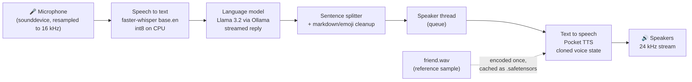

# Local Voice Assistant with Voice Cloning

A fully offline voice assistant written in Python. You talk to it, it works out a reply with a local language model, and it answers out loud in a cloned voice. All of it runs on a laptop CPU, with no dedicated graphics card, cloud API or subscription.

Developed and tested on Windows 11 with Intel Iris Xe integrated graphics.



---

## Contents

- [Features](#features)
- [How it works](#how-it-works)
- [Tech stack](#tech-stack)
- [Requirements](#requirements)
- [Installation](#installation)
- [Recording the voice sample](#recording-the-voice-sample)
- [Usage](#usage)
- [Configuration](#configuration)
- [Project structure](#project-structure)
- [Troubleshooting](#troubleshooting)
- [Limitations](#limitations)
- [Ethics and consent](#ethics-and-consent)
- [Possible improvements](#possible-improvements)
- [Credits](#credits)

---

## Features

- **Runs entirely on your own machine.** Once the models are downloaded, nothing you say leaves your computer.
- **CPU only.** Every model was picked to run acceptably without an NVIDIA GPU.
- **Voice cloning from a short sample.** About 20 to 30 seconds of clean speech is enough to copy a voice.
- **Streaming replies.** The assistant starts speaking the first sentence while the language model is still writing the rest.
- **Conversation memory.** It remembers the last 8 exchanges, so follow-up questions make sense.
- **Talk or type.** Press Enter to speak, or type a message instead.
- **Interruptible.** Press Ctrl+C while it is talking to cut it off without quitting.
- **Fast restarts.** The voice sample is processed once and cached, so later starts skip that step.
- **Helpful errors.** Common setup problems (Ollama not running, model not downloaded, missing recording, voice cloning not unlocked) print a plain-English fix instead of a stack trace.

---

## How it works

Each turn goes through four stages:

| Stage | What happens | Component |
|---|---|---|
| 1. Hear | The microphone is recorded until you press Enter, then resampled to 16 kHz mono | `sounddevice`, `scipy` |
| 2. Transcribe | Speech is converted to text, with voice-activity detection to drop silence | `faster-whisper` (`base.en`, int8) |
| 3. Think | The text and recent history are sent to a local LLM, which streams its reply back token by token | Ollama running `llama3.2` |
| 4. Speak | Finished sentences are cleaned up and queued, then a background thread turns each one into audio in the cloned voice and plays it | Pocket TTS |

### Design decisions

**Sentence-level streaming.** Waiting for the whole reply before speaking makes the assistant feel slow. Instead, the reply is split into sentences as it arrives (`pop_sentences`), and each finished sentence goes straight into a queue. A separate `Speaker` thread consumes the queue, so speech generation and text generation overlap. Very short fragments are held back and joined to the next sentence so the speech doesn't sound choppy, and abbreviations such as "e.g." and "Dr." aren't treated as sentence endings.

**Cleaning text for speech.** LLMs like to use markdown and emoji, which a TTS model would try to read aloud. `clean_for_speech` strips these before synthesis, and the system prompt also asks the model to reply in short, spoken-style sentences.

**Voice caching.** Encoding the reference recording into a "voice state" is the slowest part of startup. The result is saved as `friend.voice.safetensors` and reused until the recording changes (comparing file modification times).

**Sample-rate fallback.** Pocket TTS outputs 24 kHz audio, which some sound cards refuse. The script checks this at startup and, if needed, resamples to the card's own rate.

**Cancellation.** A `threading.Event` is passed into the TTS generator. Pressing Ctrl+C sets it, empties the queue and stops playback mid-sentence while leaving the assistant ready for the next turn.

---

## Tech stack

| Purpose | Tool |
|---|---|
| Language | Python 3.10 to 3.14 (3.12 recommended) |
| Speech to text | [faster-whisper](https://github.com/SYSTRAN/faster-whisper) (CTranslate2 build of OpenAI Whisper) |
| Language model | [Ollama](https://ollama.com) with [Llama 3.2](https://ollama.com/library/llama3.2) (3B, or 1B for slower machines) |
| Text to speech / cloning | [Pocket TTS](https://github.com/kyutai-labs/pocket-tts) by Kyutai (100M parameters, CPU-optimised) |
| Audio I/O | `sounddevice` (PortAudio), `soundfile` |
| Signal processing | NumPy, SciPy (`resample_poly`) |
| HTTP | `requests` (Ollama's local REST API) |

---

## Requirements

- Windows 11 (macOS and Linux should also work, but are untested)
- Python 3.10 to 3.14
- Around 4 GB of free disk space for the models
- 8 GB of RAM or more recommended
- A microphone and speakers or headphones
- A free [Hugging Face](https://huggingface.co) account (the voice-cloning model is gated)

No GPU is needed.

---

## Installation

### 1. Install Python

Download Python 3.12 from [python.org](https://www.python.org/downloads/) and tick **"Add python.exe to PATH"** during installation.

### 2. Install Ollama and download the model

Install Ollama from [ollama.com](https://ollama.com), then run:

```powershell
ollama pull llama3.2
```

### 3. Install the Python packages

```powershell
python -m pip install "pocket-tts>=3.3" faster-whisper sounddevice soundfile
```

> Use `python -m pip` rather than plain `pip`. On Windows they can point to different Python installations, which leads to "No module named ..." errors later.

### 4. Unlock voice cloning

The Pocket TTS cloning weights are free but gated:

1. Create an account at [huggingface.co](https://huggingface.co) and confirm your email.
2. Open [huggingface.co/kyutai/pocket-tts](https://huggingface.co/kyutai/pocket-tts) and accept the terms. This shares your username and email with Kyutai.
3. Log in from the terminal:

   ```powershell
   python -m huggingface_hub.cli.hf auth login
   ```

   Choose **Log in with your browser**, open the link it prints, and enter the code.
4. Check it worked:

   ```powershell
   python -m huggingface_hub.cli.hf auth whoami
   ```

### 5. Add the voice sample

Put a recording named `friend.wav` in the same folder as `voice_assistant.py`. See the next section for how to record a good one.

---

## Recording the voice sample

The clone copies the quality of the sample as well as the voice, so this step matters more than any setting.

- **Get consent first.** The person whose voice it is should record the sample themselves, knowing what it is for.
- **Length:** 20 to 30 seconds of continuous, natural speech. Only the first 30 seconds are used.
- **Environment:** a quiet room, with no music, background voices or echo.
- **Source:** record directly with a phone voice recorder or a microphone. Audio taken from compressed videos sounds noticeably worse.
- **Format:** the file must really be audio. Renaming an `.mp4` or `.m4a` to `.wav` does not convert it. Convert it properly, for example with FFmpeg:

  ```powershell
  ffmpeg -i recording.m4a -ac 1 -ar 24000 friend.wav
  ```

  Or import it into a DAW such as Ableton and export it as WAV.
- Optionally, run it through a speech enhancer such as [Adobe Podcast Enhance](https://podcast.adobe.com/enhance) first, as the Pocket TTS authors recommend.

---

## Usage

From the project folder:

```powershell
python voice_assistant.py
```

The first run downloads the Whisper and Pocket TTS models and processes the voice sample, so it takes a few minutes. Later runs start much faster.

Then:

- Press **Enter** to start talking, and **Enter** again when you finish.
- Or **type a message** and press Enter.
- Press **Ctrl+C** while it is speaking to interrupt it.
- Type **`quit`** to exit.

### Command-line options

| Option | Description |
|---|---|
| `--list-devices` | List audio devices and their numbers, then exit |
| `--mic N` | Use microphone number `N` |
| `--speaker N` | Use output device number `N` |
| `--voice FILE` | Clone a different recording instead of `friend.wav` |
| `--model NAME` | Use a different Ollama model, such as `llama3.2:1b` |

Example, using a specific microphone and a smaller model:

```powershell
python voice_assistant.py --mic 3 --model llama3.2:1b
```

---

## Configuration

Settings are at the top of `voice_assistant.py`:

| Setting | Default | What it does |
|---|---|---|
| `VOICE_SAMPLE` | `"friend.wav"` | The recording to clone |
| `LLM_MODEL` | `"llama3.2"` | The Ollama model; `"llama3.2:1b"` is faster and uses less memory |
| `WHISPER_MODEL` | `"base.en"` | `"tiny.en"` is faster, `"small.en"` is more accurate |
| `OLLAMA_URL` | `"http://127.0.0.1:11434"` | Where Ollama is listening |
| `PERSONALITY` | Friendly, short spoken replies | The system prompt; edit it to change the assistant's name and personality |
| `STREAM_AUDIO` | `True` | Play audio as it is generated; set to `False` if playback stutters |
| `MEMORY_TURNS` | `8` | How many past exchanges are sent back to the model |

---

## Project structure

```
voice-assistant/
├── voice_assistant.py          # the whole application
├── friend.wav                  # voice sample (not committed, see below)
├── friend.voice.safetensors    # cached voice state, created on first run
├── README.md
└── screenshots/
    └── architecture.png        # pipeline diagram
```

Main parts of `voice_assistant.py`:

| Function / class | Role |
|---|---|
| `record()` | Captures microphone audio until Enter and resamples it to 16 kHz |
| `transcribe()` | Runs faster-whisper with voice-activity detection |
| `check_ollama()` | Confirms Ollama is running and the model is downloaded, then preloads it |
| `ask()` | Streams a reply from Ollama's `/api/chat` endpoint |
| `pop_sentences()` | Splits streamed text into speakable sentences |
| `clean_for_speech()` | Removes markdown symbols and emoji |
| `voice_files()` / `load_voice()` | Finds the sample and loads or builds the cached voice state |
| `Speaker` | Background thread that queues, synthesises and plays sentences, with cancellation |
| `main()` | Parses arguments, loads the models and runs the conversation loop |

### Keep recordings out of Git

Voice recordings and cached voice states are personal data. Add a `.gitignore`:

```gitignore
*.wav
*.mp3
*.m4a
*.safetensors
__pycache__/
```

---

## Troubleshooting

| Problem | Cause | Fix |
|---|---|---|
| `hf : The term 'hf' is not recognized` | Python's Scripts folder isn't on PATH | Run `python -m huggingface_hub.cli.hf auth login` instead |
| `No module named huggingface_hub` (or another package) | `pip` installed into a different Python than `python` runs | Reinstall with `python -m pip install ...` |
| `wave.Error: file does not start with RIFF id` | The "WAV" file is really another format, such as a renamed MP4 | Convert it properly (see [Recording the voice sample](#recording-the-voice-sample)) |
| `Voice cloning isn't unlocked yet` | The Hugging Face terms weren't accepted, or you aren't logged in | Repeat [step 4](#4-unlock-voice-cloning) |
| `Can't reach Ollama` | Ollama isn't running | Start the Ollama app, then try again |
| `The model 'llama3.2' isn't downloaded yet` | The model wasn't pulled | Run `ollama pull llama3.2` |
| `I didn't hear any words` | The wrong microphone is selected, such as an audio interface input | Run `--list-devices` and choose one with `--mic N` |
| Speech stutters or breaks up | The CPU can't keep up with real-time streaming | Set `STREAM_AUDIO = False`, or use `llama3.2:1b` |
| Changed the recording but the voice is the same | The old cache is being used | Delete `friend.voice.safetensors` |

---

## Limitations

- **Accents aren't reproduced well.** Pocket TTS copies the tone and texture of a voice better than its accent, and tends to fall back to its own default pronunciation. Strong regional accents, such as Irish ones, mostly come out as a hint rather than a faithful copy.
- **English only, as configured.** Pocket TTS supports a few other languages, but the script loads the English model and Whisper's English-only model.
- **Push-to-talk.** There's no wake word or automatic end-of-speech detection; you press Enter to start and stop.
- **Latency depends on the CPU.** On a laptop without a GPU, expect a short pause before each reply.
- **Small model, small brain.** A 3B-parameter LLM is fine for chatting but makes factual mistakes and has no internet access.

---

## Ethics and consent

Voice cloning can be misused for impersonation, scams and misinformation. This project should only be used with a voice whose owner has clearly agreed to it.

- Only clone someone's voice with their explicit permission. The Pocket TTS terms prohibit cloning "without explicit and lawful consent".
- Never present generated audio as a real recording of that person.
- Don't use the cloned voice to deceive anyone, for example on phone calls or voice messages.
- Keep the voice sample and cached voice state private, and delete them if the person withdraws consent.

---

## Possible improvements

- Wake-word activation (for example with openWakeWord) instead of pressing Enter
- Automatic end-of-speech detection using Silero VAD
- Saving conversation history to a file between sessions
- A simple GUI, or a web interface using Pocket TTS's built-in server
- Letting the user interrupt by speaking over the assistant
- Tool use, such as telling the time, checking the weather or setting timers
- Comparing larger cloning models (such as XTTS-v2 or Chatterbox) on GPU hardware to improve accent fidelity

---

## Credits

- [Pocket TTS](https://github.com/kyutai-labs/pocket-tts) by Kyutai, used under its licence and terms of use
- [faster-whisper](https://github.com/SYSTRAN/faster-whisper) by SYSTRAN, based on OpenAI's Whisper
- [Ollama](https://ollama.com) and Meta's [Llama 3.2](https://ollama.com/library/llama3.2)
- Built by Joey Ronan with AI assistance
